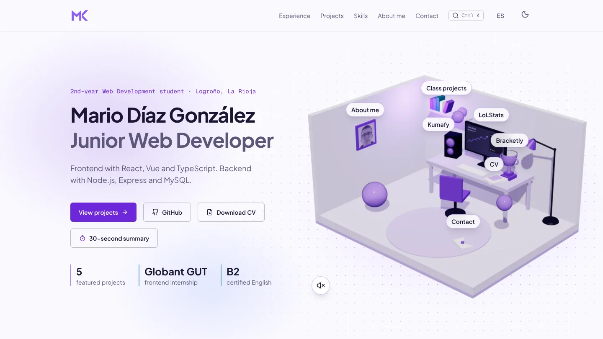

# Mario Díaz González · Portfolio

Personal portfolio of Mario Díaz González, a 2nd-year Web Application Development (DAW) student in Logroño, Spain, with a frontend internship at Globant GUT.

**Live site:** https://mk-1379.github.io/

<picture>
  <source media="(prefers-color-scheme: dark)" srcset="docs/hero-dark.webp" />
  
</picture>

## Highlights

- **Interactive 3D desk** built with Three.js. Each labelled object (projects, CV, "About me", contact) opens its own panel, and the monitor shows the project screenshots. Click reactions, camera zoom, a gradual day/night cycle with a floor lamp, and optional sounds (off by default).
- **Works without WebGL too.** On mobile, without a hardware GPU or with `prefers-reduced-motion`, the 3D scene is replaced by a static image with accessible buttons, so nobody gets a blank hero.
- **Bilingual (ES/EN)** with a language toggle; every text lives in typed `{ es, en }` objects.
- **Command palette** (`Ctrl + K`) to jump to any section, project or action from the keyboard.
- **30-second summary** dialog for recruiters who only have half a minute.
- **Live project status:** each project card shows when its repo was last updated (GitHub API, cached per session) and whether its demo is online.
- **Motion with purpose:** animated icons, word-by-word section titles, scroll-drawn timeline, project screenshots revealed on scroll and a circular theme transition with the View Transitions API. All of it respects `prefers-reduced-motion`.
- **Prerendered with `vite-ssg`**, so the HTML already contains the content (fast first paint, good SEO), plus `robots.txt`, `sitemap.xml`, Open Graph tags and a custom 404 page.
- **Light and dark themes** saved in `localStorage` and applied before the first paint, so there is no flash.
- **Automatic deploy** to GitHub Pages with GitHub Actions on every push to `main`.

## Tech stack

- [Vue 3](https://vuejs.org/) with `<script setup>` and TypeScript
- [Vite](https://vite.dev/) and [vite-ssg](https://github.com/antfu-collective/vite-ssg)
- [Vue Router](https://router.vuejs.org/)
- [Tailwind CSS 4](https://tailwindcss.com/) with design tokens as CSS variables
- [Three.js](https://threejs.org/) for the desk scene and the glass figures
- [AnimateIcons](https://github.com/Avijit07x/animateicons) (`@animateicons/vue`) for the animated icons
- Self-hosted fonts via [Fontsource](https://fontsource.org/): Plus Jakarta Sans and Geist Mono
- ESLint, Oxlint and Prettier

## Getting started

Requires Node.js 22.18+ or 24.12+.

```bash
git clone https://github.com/MK-1379/MK-1379.github.io.git
cd MK-1379.github.io
npm install
npm run dev
```

| Command | What it does |
|---|---|
| `npm run dev` | Starts the development server |
| `npm run build` | Type-checks and builds the prerendered site into `dist/` |
| `npm run preview` | Serves the production build locally |
| `npm run type-check` | Runs `vue-tsc` |
| `npm run lint` | Runs Oxlint and ESLint |
| `npm run format` | Formats `src/` with Prettier |

## Project structure

```text
.github/workflows/deploy.yml   Build and deploy to GitHub Pages
docs/                          Screenshots used in this README
public/                        Static files: images, CVs, favicon, robots and sitemap
src/
  assets/main.css              Tailwind import, theme tokens and animations
  components/                  Page sections and UI pieces
  composables/                 Reusable logic: theme, desk scene, sound, project status, command palette
  data/                        Editable content: profile, experience, projects, skills, languages
  directives/                  v-magnetic and v-pause-offscreen
  effects/                     Paper plane animation when copying the email
  i18n/                        Current locale and UI texts in Spanish and English
  scenes/                      Three.js desk scene, its interactive items and GPU detection
  types/index.ts               TypeScript interfaces for the data
  views/HomeView.vue           Home page composed from the sections
  main.ts                      App entry point (ViteSSG)
```

## Editing the content

Most changes only need one file in `src/data/`:

- `profile.ts`: name, role, contact links, the 30-second summary and the "About me" text
- `experience.ts`: work experience timeline
- `projects.ts`: the projects list (screenshots go in `public/img/projects/`)
- `skills.ts`: skills grouped by level (used in projects, base knowledge, next step)
- `languages.ts`: spoken languages and certificates

Interface texts (buttons, headings) are in `src/i18n/messages.ts`.

## Credits

- Skill icons from [Devicon](https://devicon.dev/) (MIT, see `public/img/skills/LICENSE`).
- Animated icons from [AnimateIcons](https://github.com/Avijit07x/animateicons) (MIT), based on [Lucide](https://lucide.dev/).
- The hero background images used when the 3D scene is off were generated with AI ([Higgsfield](https://higgsfield.ai/)).
- The LoLStats screenshot contains assets owned by Riot Games. This portfolio is not endorsed or sponsored by Riot Games.
- Fonts are distributed under the SIL Open Font License.
